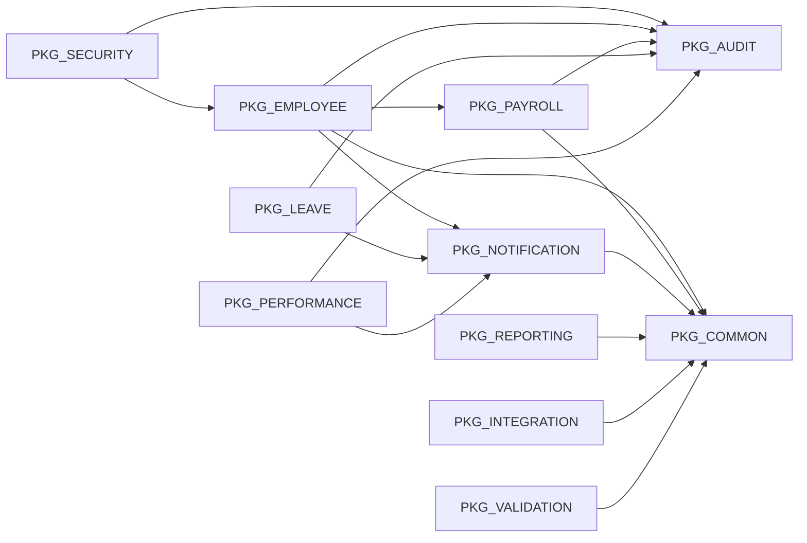

# Dependency Map — Legacy HRMS (Oracle Forms / PL/SQL)

Source analysed: `ts-plsql-oracle-forms-legacy-codebase` @ `1c33787`. Package and table references were extracted from the source with comments stripped (`PKG_x.` calls, `INSERT/UPDATE/DELETE/MERGE` targets, table names); Forms calls come from trigger bodies in the XML exports. Rule IDs refer to the [business rules catalog](business-rules-catalog.md).

## 1. Forms → packages and tables

| Form | Calls | Reads | Writes | Opens |
|---|---|---|---|---|
| `HRMS_LOGIN` | `PKG_SECURITY.authenticate` | `EMPLOYEES` | — (via package: `USER_SESSIONS`) | `HRMS_MENU` |
| `HRMS_MENU` | `PKG_SECURITY.has_permission`, `logout` | — | — | `HRMS_EMPLOYEE`, `HRMS_PAYROLL`, `HRMS_LEAVE`, `HRMS_PERFORMANCE`, `HRMS_REPORTS`*, `HRMS_ADMIN`* |
| `HRMS_EMPLOYEE` | `PKG_SECURITY.is_session_valid`, `has_permission`; `PKG_EMPLOYEE.generate_emp_number`; `PKG_VALIDATION.validate_email_format` | `EMPLOYEES`, `DEPARTMENTS`, `JOB_TITLES`, `JOB_GRADES`, `LOCATIONS`, `SALARY_RECORDS`, `EMERGENCY_CONTACTS` (LOVs/display) | **`EMPLOYEES` directly** (base-table block, BR-EMP-026) | — |
| `HRMS_LEAVE` | `PKG_SECURITY.is_session_valid`; `PKG_LEAVE.submit_leave_request`, `cancel_leave_request` | `LEAVE_REQUESTS`, `LEAVE_BALANCES`, `LEAVE_TYPES` | — (via package) | — |
| `HRMS_PAYROLL` | `PKG_SECURITY.is_session_valid`, `has_permission`; `PKG_PAYROLL.create_payroll_run`, `calculate_payroll`, `approve_payroll` | `PAY_PERIODS`, `PAYROLL_RUNS` | — (via package) | — |
| `HRMS_PERFORMANCE` | `PKG_SECURITY.is_session_valid` | `REVIEW_CYCLES`, `PERFORMANCE_REVIEWS`, `PERFORMANCE_GOALS`, `EMPLOYEES` | blocks are query-only in export | — |

\* Referenced but not in the repo (evidence request in the catalog §0).

All forms attach `HRMS_COMMON_LIB` (→ `PKG_COMMON.log_error`, `PKG_SECURITY.is_session_valid`) and `HRMS_VALIDATION_LIB` (→ `JOB_GRADES`). The menu module `HRMS_MENU.mmb` adds File/Edit/Query/Navigate/Modules/Admin/Help menus; Admin items (System Parameters, User Management, Change Password) have no form in the repo.

## 2. Package → package calls

Findings:

- **No circular dependency in code.** `PKG_PAYROLL.pks` says it depends on `PKG_EMPLOYEE` ("circular dependency … is_active check"), but the body never calls `PKG_EMPLOYEE`. Only `PKG_EMPLOYEE → PKG_PAYROLL.create_salary_record` exists. The Java `PayrollService` can be built without depending on `EmployeeService`; `EmployeeService` calls `PayrollService` (or publishes `EmployeeHiredEvent`).
- `PKG_SECURITY → PKG_EMPLOYEE.set_session_context` is the only reverse edge; it sets session context and disappears with JWT.
- `PKG_LEAVE` and `PKG_EMPLOYEE` write each other's data directly instead of calling each other: `PKG_EMPLOYEE.terminate_employee` updates `LEAVE_REQUESTS` (BR-EMP-018).
- `PKG_VALIDATION` is called only by the Employee form, never by another package. Server-side validation in packages is re-implemented inline.
- `PKG_AUDIT`, `PKG_COMMON` and `PKG_NOTIFICATION` are leaf/shared services → Spring cross-cutting components (audit listener, config, async mail).

## 3. Package → tables (W = insert/update/delete, R = read only)

| Package | Writes | Reads |
|---|---|---|
| `PKG_EMPLOYEE` | `EMPLOYEES`, `EMPLOYEE_HISTORY`, `SALARY_RECORDS`, `EMPLOYEE_PAY_ELEMENTS`, `LEAVE_REQUESTS` | `DEPARTMENTS`, `JOB_TITLES`, `JOB_GRADES` |
| `PKG_PAYROLL` | `SALARY_RECORDS`, `PAY_PERIODS`, `PAYROLL_RUNS`, `PAYROLL_DETAILS` | `EMPLOYEES`, `DEPARTMENTS`, `PAY_ELEMENTS`, `EMPLOYEE_PAY_ELEMENTS`, `EMPLOYEE_TAX_INFO` |
| `PKG_LEAVE` | `LEAVE_REQUESTS`, `LEAVE_BALANCES`, `LEAVE_ACCRUAL_LOG` | `LEAVE_TYPES`, `HOLIDAYS`, `EMPLOYEES` |
| `PKG_PERFORMANCE` | `REVIEW_CYCLES`, `PERFORMANCE_REVIEWS`, `PERFORMANCE_GOALS` | `EMPLOYEES`, `DEPARTMENTS`, `JOB_TITLES` |
| `PKG_SECURITY` | `USER_SESSIONS` | `EMPLOYEES`, `JOB_TITLES` |
| `PKG_NOTIFICATION` | `NOTIFICATION_QUEUE` | `EMPLOYEES` |
| `PKG_AUDIT` | `AUDIT_LOG` | — |
| `PKG_COMMON` | `AUDIT_LOG`, `SYSTEM_PARAMETERS` | — |
| `PKG_VALIDATION` | — | `EMPLOYEES`, `JOB_GRADES`, `HOLIDAYS` |
| `PKG_REPORTING` | — | `EMPLOYEES`, `DEPARTMENTS`, `LOCATIONS`, `JOB_GRADES`, `JOB_TITLES`, `SALARY_RECORDS`, `PAYROLL_RUNS`, `PAYROLL_DETAILS`, `LEAVE_TYPES`, `LEAVE_BALANCES` |
| `PKG_INTEGRATION` | — (files only) | `EMPLOYEES`, `EMPLOYEE_DEPENDENTS`, `DEPARTMENTS`, `PAY_ELEMENTS`, `PAY_PERIODS`, `PAYROLL_RUNS`, `PAYROLL_DETAILS` |

**Shared-write tables** (need one owning module in the target):

| Table | Writers | Proposed owner |
|---|---|---|
| `SALARY_RECORDS` | `PKG_EMPLOYEE` (end-date on termination), `PKG_PAYROLL` | Payroll |
| `EMPLOYEE_PAY_ELEMENTS` | `PKG_EMPLOYEE` (end-date on termination) | Payroll |
| `LEAVE_REQUESTS` | `PKG_LEAVE`, `PKG_EMPLOYEE` (cancel on termination) | Leave (listen to `EmployeeTerminatedEvent`) |
| `AUDIT_LOG` | `PKG_AUDIT`, `PKG_COMMON`, `trg_audit.sql` | Audit |
| `EMPLOYEE_HISTORY` | `PKG_EMPLOYEE`, `trg_employees.sql` | Employee |

**Tables with no code reference** (only DDL/seed): `EMERGENCY_CONTACTS` (form display only), `EMPLOYEE_BANK_ACCOUNTS`, `TAX_BRACKETS`, `LOOKUP_VALUES`. Bank accounts are needed for payment files; tax brackets can replace the hard-coded constants (BR-PAY-012).

## 4. Database triggers

| Trigger | Table / event | Effect | Calls |
|---|---|---|---|
| `TRG_EMP_BEFORE_INSERT` | `EMPLOYEES` BEFORE INSERT | defaults, hire-date ≤ +180 d, unique active e-mail | — |
| `TRG_EMP_BEFORE_UPDATE` | `EMPLOYEES` BEFORE UPDATE | audit columns, blocks TERMINATED→ACTIVE, writes `EMPLOYEE_HISTORY` (schema mismatch, BR-EMP-031) | — |
| `TRG_EMP_BEFORE_DELETE` | `EMPLOYEES` BEFORE DELETE | forbids delete | — |
| `TRG_SALARY_AUDIT` | `SALARY_RECORDS` AFTER INSERT/UPDATE/DELETE | audit row | `PKG_AUDIT.log_action` |
| `TRG_LEAVE_REQUEST_AUDIT` | `LEAVE_REQUESTS` AFTER UPDATE OF STATUS | audit row (`STATUS_CHANGE`, dropped by check constraint, BR-CMN-004) | `PKG_AUDIT.log_action` |
| `TRG_DEPARTMENT_AUDIT` | `DEPARTMENTS` AFTER INSERT/UPDATE/DELETE | audit row | `PKG_AUDIT.log_action` |

## 5. Batch / scheduled entry points

No `DBMS_SCHEDULER` job definitions are in the repo. These entry points are described as scheduled in source comments; frequencies marked "?" need confirmation.

| Entry point | Frequency (from comments) | Target |
|---|---|---|
| `PKG_LEAVE.run_monthly_accrual` | 1st of each month | Spring Batch job |
| `PKG_LEAVE.process_carryover`, `expire_carryover` | year end / expiry date ? | Spring Batch job |
| `PKG_PAYROLL.calculate_payroll` | per pay period (form or scheduler) | Spring Batch job (ADR-004) |
| `PKG_PAYROLL.generate_pay_periods` | yearly ? | admin endpoint |
| `PKG_NOTIFICATION.process_queue` / `retry_failed` | every 5 minutes | `@Scheduled` + mail sender |
| `PKG_AUDIT.purge_old_records` | ? | `@Scheduled` |
| `PKG_INTEGRATION` GL / benefits exports | after payroll approval ? | Spring Batch job |
| `PKG_REPORTING.refresh_reporting_tables` | nightly ? (placeholder) | — |

## 6. External interfaces

| Interface | Direction | Mechanism | Source |
|---|---|---|---|
| SMTP mail | out | `UTL_SMTP`, host/port/from hard-coded | `PKG_NOTIFICATION` |
| Pay register CSV | out | `UTL_FILE`, directory `PAYROLL_OUTPUT` | `PKG_PAYROLL.generate_pay_register` |
| GL journal file | out | `UTL_FILE`, pipe-delimited | `PKG_INTEGRATION` |
| Benefits (ADP-style) | out | `UTL_FILE`, fixed width | `PKG_INTEGRATION` |
| Time & attendance CSV | in | `UTL_FILE` (stub) | `PKG_INTEGRATION` |
| Directory / org sync | ? | placeholder | `PKG_INTEGRATION` |

## 7. Impact on migration order

The order in [migration-strategy.md](migration-strategy.md) (Security → Employee → Leave → Payroll → Performance → Reports → Integration) fits the dependency graph, with these adjustments:

1. **Shared services first.** Audit, system parameters and notification queue (`PKG_AUDIT`, `PKG_COMMON`, `PKG_NOTIFICATION`) are used by every module; port them as part of the Security/foundation step.
2. **Employee needs a salary port.** `create_employee`, `promote_employee`, `rehire_employee` and `terminate_employee` write `SALARY_RECORDS`/`EMPLOYEE_PAY_ELEMENTS`. Either migrate `create_salary_record`/`get_current_salary` with Employee, or keep calling the PL/SQL procedure during dual-run.
3. **Leave termination hook.** Employee termination cancels leave; publish `EmployeeTerminatedEvent` and handle it in Leave once Leave is migrated.
4. **Payroll does not depend on Employee services**, only on the `EMPLOYEES` table, so the planned interface-based decoupling is simpler than the assessment report assumes.
